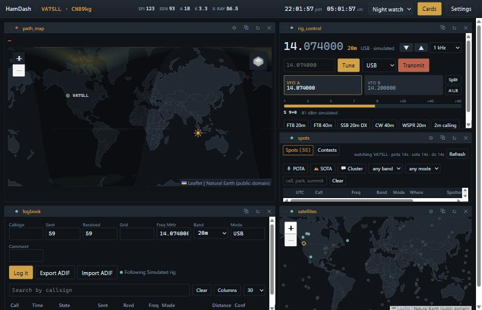
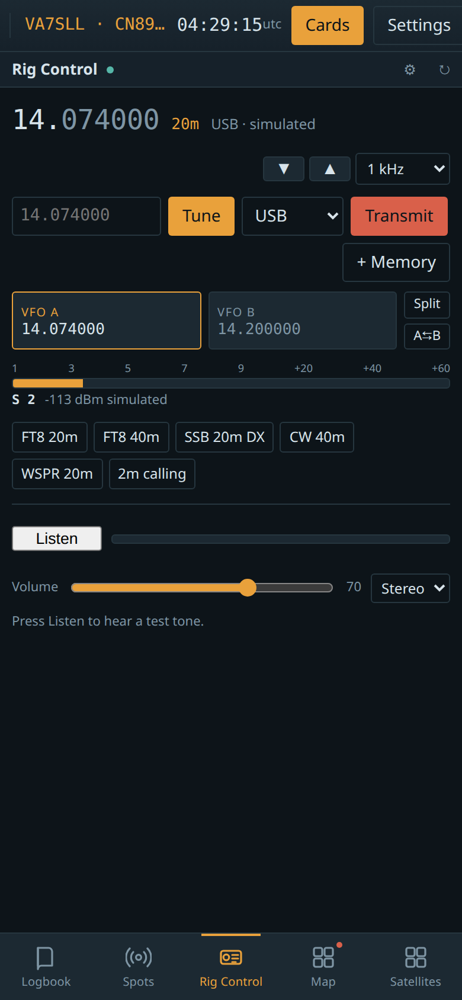
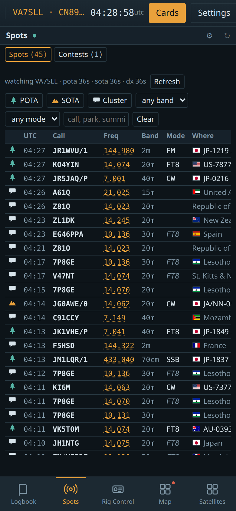
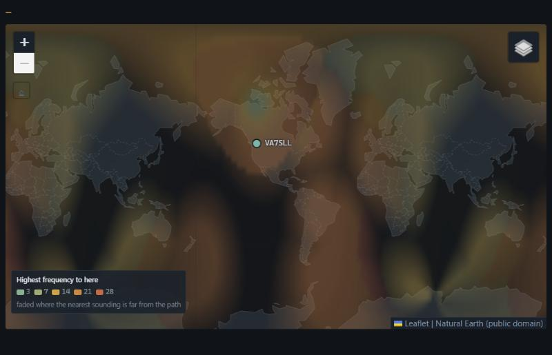
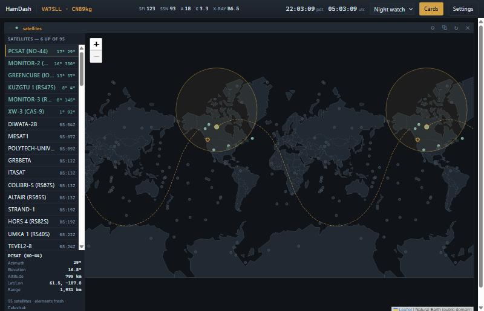
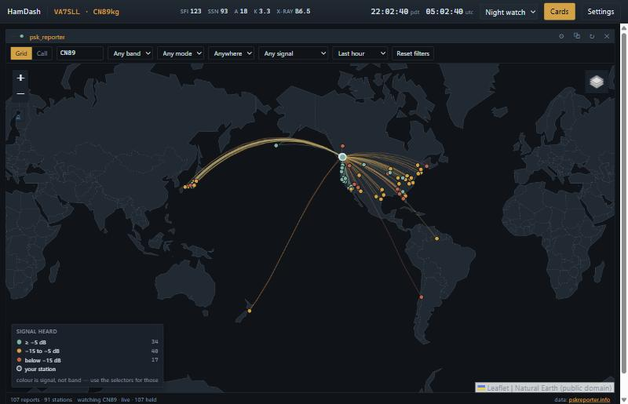

# hamdash

**A card-based ham radio dashboard.** Rig control, logging, spots, maps,
CW decoding, satellites and remote audio — arranged however you like, and
you can add your own cards.

Runs as a desktop app on Windows, macOS and Linux: no server to configure,
no localhost URL to remember, nothing installed system-wide. **It works on
your phone too** — open the board from it and it becomes one card at a time
with a bar along the bottom.



<sub>Solar flux, sunspot number, A, K and the X-ray flare class sit along the
top bar beside the clock. Everything below here is one board. Drag the tiles where you want them, stack them into tabs and drag the tabs into order, or pop one out into its own window.</sub>

**Want your own card on the board?** [docs/cards.md](docs/cards.md) is the
whole contract, and [docs/card-template](docs/card-template) is a card that
runs as it stands — copy it into your cards folder, press **Rescan**, and it
is there. It carries a `CLAUDE.md` if you would like Claude Code to write it
with you.

## Run it

```bash
pip install -r requirements.txt
python run.py                 # native window (pywebview)
python run.py --browser       # serve on http://127.0.0.1:8765 instead
python run.py --home ./dev    # use a throwaway config directory
python run.py --stop          # ask a running one to close properly
```

Your config, log and cards live in one directory:
`%APPDATA%\hamdash` / `~/Library/Application Support/hamdash` / `~/.config/hamdash`
(or `HAMDASH_HOME`). Back it up by copying that folder.

Out of the box the radio is **simulated**, so everything is usable with no
hardware. For a real rig, add it in Settings → Radio — hamdash speaks
**flrig**, **OmniRig**, **Hamlib** and a **rigctld** you are already running,
and starts Hamlib's daemon for you. Up to ten radios can be set up, and
each can have a Rig Control tile of its own.

Hamlib is a program rather than a Python package, so `pip` cannot bring it:

```bash
python tools/get_hamlib.py     # downloads the official build, checksum-verified
```

Or run `rigctld` yourself and add it in Settings → Radio as **rigctld**,
with its host and port:

```bash
rigctld -m 1035 -r /dev/ttyUSB0 -s 38400    # -m 1 is the Hamlib dummy rig
```

## On your phone

Open the same board from a phone's browser and it lays itself out for the
screen: **one card at a time**, full width, with a bar along the bottom to
switch between them — four and a **More**. Cards start only when you first
open them, so a phone is not running six cards to show you one, and the
choice of view follows the window unless you pick one yourself.

<p>

&nbsp;

</p>

To reach it from a phone, start hamdash with `--host` (see
[Putting it on your network](#putting-it-on-your-network)). More in
[docs/board.md](docs/board.md#on-a-phone).

## What is on the board

Eleven cards ship with it, and a tile can hold any of them:

- **Rig Control** — the dial, mode, both VFOs, split, a meter that shows
  signal while receiving and power while transmitting, **memory buttons**
  you save, name, rearrange and delete, and **Listen**: the radio's receive
  audio in the browser, so the board is usable from another machine on your
  network. Each radio can have a tile of its own, so two radios are tuned,
  metered and heard side by side — one in each ear if you like.
- **Logbook** — log a contact, search it, import and export ADIF, and sync
  with LoTW, QRZ or World Radio League.
- **Spots** — POTA, SOTA, the DX cluster, contests and the nets running now,
  plus live
  telnet feeds from the Reverse Beacon Network, which answers the question
  nothing else here does: *who can hear me*.
- **PSK Reporter** — who is receiving whom, on a map.
- **Satellites** — which amateur satellites are up, when the next pass is,
  and where they are going.
- **Map** — great-circle path, greyline, aurora and space weather, and
  **Band to here (MUF)**: what frequency will reach each place on the map,
  from the ionosondes that have actually sounded in the last two hours.
- **Path to Station** — bearing and distance to the station you are
  looking at.
- **Spectrum** — a waterfall from the radio's sound card.
- **Decoder** — live CW off the air, with the DSP tested against synthesised
  Morse from 6 to 45 WPM.
- **Web Page** — any page in a tile. **Cards → New from URL…** makes a named
  card out of one without your writing anything, and deletes it again.
- **Hello Card** — the example, in about thirty lines.

Everything is usable with no radio attached: the rig is in mock mode until
you tell it otherwise.


### What band will reach them

**Band to here (MUF)** sweeps one calculation across the map: for every place,
the highest frequency that will carry a path from *your* station to it. That is
a different map from the usual MUF chart, which plots MUF(3000) at each point
and says nothing about where you are standing.

It is a measurement, not a model — the numbers come from ionosondes that have
actually sounded in the last two hours. About 30 of the 97 stations are live at
any moment and they cluster over Europe, North America and Australia, so the
overlay **fades where the nearest sounding is far from the path**. The oceans
look like the guess they are.



### Satellites

Which amateur satellites are above you now, when the next pass is, and
where each one is going. Click one for its footprint and ground track.



### PSK Reporter

Who is hearing you, and who you are hearing — live, from PSK Reporter's
own feed, with every filter running against what is already on your disk.



## Documentation

| | |
|---|---|
| **[Using the board](docs/board.md)** | moving cards, stacking them into tabs, popping one out, tile settings, themes |
| **[Radios](docs/radios.md)** | flrig, OmniRig, Hamlib and rigctld; VFOs, split, the meter, and the transmitter rules |
| **[Logging and callsigns](docs/logging.md)** | the log, syncing it with LoTW, QRZ and WRL, lookups, grids and flags |
| **[The cards that come with it](docs/built-in-cards.md)** | memories, listening, spectrum, CW decoder, PSK Reporter, satellites, spots |
| **[Writing a card](docs/cards.md)** | the whole extension contract, with a [template](docs/card-template) you can copy |
| **[The bus](docs/bus.md)** | one pub/sub channel for the board, and who may say what |
| **[When something goes wrong](docs/troubleshooting.md)** | where to look, and the failure modes worth knowing |
| **[Building and testing](docs/building.md)** | the test suite, and making a desktop app out of the tree |

## Shape of the thing

```
run.py ──> hamdash/app.py            Flask: static shell, REST API, SSE bus, card proxy
             ├── bus.py              pub/sub, last-value cache, SSE stream
             ├── registry.py         reads card.json from plugins/ and <home>/cards/
             ├── proc.py             one OS process per python card, restart with backoff
             ├── config.py           config.json, layout.json, search paths
             ├── services/           radios, audio, callsign, logbook, bands, grid math
             ├── sdk/                what a card author imports
             └── static/             board, drag/resize, themes, card palette
plugins/     rig_control, logbook, spots, path_map, beacon_map, psk_reporter,
             satellites, spectrum, decoder, web_embed, hello_card
```

Why processes and not imports: a card someone wrote at 1am shouldn't be able to
hang the UI, crash the host, or drag a conflicting dependency into it. The host
reverse-proxies `/cards/<id>/*` to the card's own loopback port, so cards are
same-origin to the browser and their ports are never exposed.

## Not done yet

Freeing a tile's grid slot while its card is popped out; remembering where
popped-out windows were across a restart; RTTY and PSK31 in the decoder;
multiple boards as tabs; transmitting from another machine (receiving already
works — a microphone needs a secure context, so it means HTTPS or a tailnet).

On packaging: Linux builds (CI builds Windows and macOS, which both have a
pip-installable pywebview backend — Linux needs system GTK/WebKit packages
and a build without them would silently be browser-only), code signing, and
an application icon.

The full list, with the reasoning and what was measured, is under
[Open threads in CLAUDE.md](CLAUDE.md#open-threads) — kept there rather than
here so there is one list to keep true rather than two that drift. This
paragraph used to claim ADIF import dedupe, the per-card settings UI and
LoTW/QRZ upload were outstanding; all three had been done for a while.

## Putting it on your network

By default hamdash listens on `127.0.0.1` and is reachable only from the
computer it runs on. `--host` changes that, which is how you use the board
from a tablet on the sofa or a second PC:

```bash
python run.py --host 192.168.1.50 --port 4444 --browser
```

> **There is no login.** Anyone who can reach that address can tune your
> radio, **transmit with it**, edit your log and read or overwrite your
> settings, including saved passwords. hamdash has no accounts and no
> password — that is a deliberate choice to keep it simple for a
> single-operator station, not an oversight.

So only do it on a network you trust, and prefer naming one interface over
`0.0.0.0`, which offers the board on every network the machine later joins.
If you want it from outside the house, use a VPN such as Tailscale rather
than forwarding a port. More in [docs/built-in-cards.md](docs/built-in-cards.md#listening-from-another-machine)
and [SECURITY.md](SECURITY.md).

## A word about installing cards

A card is a program on your machine, and a card's *page* is not sandboxed
from the rest of the dashboard: every card shares one origin with the board,
so a card that wanted to could read your logbook or use a shared service it
never declared. Measured, not assumed — the detail is in
[docs/cards.md](docs/cards.md#honest-about-what-permissions-are).

A card's *server* calls are properly enforced and cannot reach an undeclared
service. But `permissions` in a manifest is a declaration of intent, not a
sandbox. **Install cards you trust, and read them first.**

## Licence

MIT — see [LICENSE](LICENSE).

Bundled with it, each keeping its own licence beside the files:

| | |
|---|---|
| [Leaflet](https://leafletjs.com) and [proj4js](https://proj4js.org) | BSD-2 — `hamdash/static/vendor/` |
| [flag-icons](https://github.com/lipis/flag-icons) | MIT — `hamdash/static/flags/` |
| [satellite.js](https://github.com/shashwatak/satellite-js) | MIT — `hamdash/static/vendor/satellite.min.js`, SGP4 orbital propagation |
| Natural Earth coastlines and boundaries | public domain, simplified into `vendor/world.js` and `vendor/borders.js` |

Hamlib is **not** bundled: `rigctl` and `rigctld` are GPL and hamdash is MIT,
so shipping them would put their licence and a source offer on every release.
`tools/get_hamlib.py` fetches them from the Hamlib project on request, and
hamdash runs `rigctld` as a separate program.
